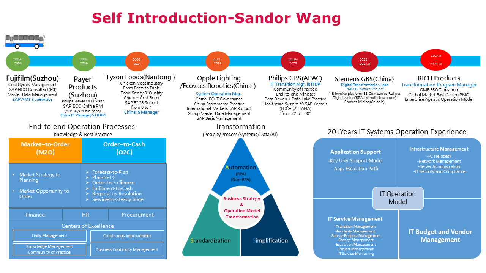

# Sandor Wang

Suzhou. Twenty-five years turning enterprise process into systems. Now I build the harness that enterprise AI has to run inside.

I don't think enterprise AI fails on models. It fails on the harness — the layer that decides who may authorise an agent's work, what it is allowed to touch, and whether anyone can prove afterwards what actually happened. The model is rented. That layer is the only part a company owns.

### The framing I work from

```
Agent       =  Models + Harness

Enterprise  =  Agentic BPM
            ×  Agentic Organization
            ×  Agent Platform
            ×  Enterprise Harness
```

The first line is additive: one agent is a model plus a harness. The second is **multiplicative** — the four dimensions are not a menu, and any one of them at zero makes the whole zero.

- **Agentic BPM** — the work: the process becomes the host, and the agent its citizen
- **Agentic Organization** — the accountability: named roles, real decisions, who carries the consequence
- **Agent Platform** — the capability: runtime, tools, memory, models that can be swapped
- **Enterprise Harness** — the proof: gates that close, ledgers that reconcile, evidence a third party can check

## Film

A 45-second film, English and Chinese tracks: five roads — process, people, technology, data, AI — each running its own way, then joined into one. Delivery 21 → 7 days. The closing line is the position in one sentence: *process automation goes to the agent; judgement stays with people.*

- Watch: https://sdr010-coder.github.io/#film
- English track: https://sdr010-coder.github.io/assets/video/agent-platform-en.mp4
- Chinese track: https://sdr010-coder.github.io/assets/video/agent-platform-zh.mp4

## Open to

Two kinds of role: forward-deployed / enterprise AI delivery at an AI company, or AI transformation PMO leadership inside an enterprise.

- Hiring page: https://sdr010-coder.github.io/hiring.html
- CV, printable: https://sdr010-coder.github.io/cv.html

## Building

**Now** — Enterprise Harness. An open definition and a small runnable implementation of the two things that decide whether an agent's output can be accepted: a named-signer mandate, and a dual ledger with a hash chain.
83 tests · Python 3.11+ · stdlib only · fail-closed by construction
→ building/enterprise-harness.html · → https://github.com/sdr010-coder/EnterpriseHARNESS

**2026** — Agent governance, in two weeks. A proof of concept for governing agents across a transformation lifecycle: which agent may do what, where it must stop for a person, and what it must leave behind. Approve, stop, audit.
475 processes · 8-step journey · 6 gates · dual ledger

**2026** — Evidence-first research. A workbench where every conclusion traces back to a source, counter-evidence is a required field rather than an afterthought, and a person signs the result.
106 evidence items · 58 sources · human sign-off

**2025–26** — A PMO platform for a global SAP S/4HANA rollout. As PMO, I designed and built the implementation's platform — from Excel and meetings to a single system of record, zero to live in four and a half months. Portfolio, plan, RAID, resources, budget, SOW.
4.5 months · 56 pages · 51 tables · 119,000 lines · 1,485 processes · 455 category standards

**Earlier** — Transformation and systems leadership. A US food company, a global medical-device maker, an industrial group, a robotics company, a lighting manufacturer, a poultry producer, digital imaging, personal care.
9 companies · 7 industries · teams up to 19 · 10 APAC markets · 9-country shared-services transition

## Writing

Notes on the harness, written while building it. No hedging.

- [Why pilots stall](https://github.com/sdr010-coder/EnterpriseHARNESS/blob/main/docs/01-the-problem.md) — the gap between "the run completed" and "the company accepted the result"
- [What an Enterprise Harness is](https://github.com/sdr010-coder/EnterpriseHARNESS/blob/main/docs/02-what-is-enterprise-harness.md) — one sentence, and the line against a platform, a framework and a runtime
- [Mandate and the six gates](https://github.com/sdr010-coder/EnterpriseHARNESS/blob/main/docs/04-mandate-and-gates.md) — why an unsigned action is never permission, and why an approval must die when the thing it approved changes
- [The dual ledger](https://github.com/sdr010-coder/EnterpriseHARNESS/blob/main/docs/05-dual-ledger.md) — why "it happened" and "it can be proven" are two different claims, and why one ledger can't make both
- [Process is the host](https://github.com/sdr010-coder/EnterpriseHARNESS/blob/main/docs/06-process-is-the-host.md) — why an enterprise governs a process, and hosts an agent inside it, not the other way round

## How I start

One enterprise, one value stream, ninety days. **1 project · 3 digital employees · 1 human gate · 1 executive weekly report.** Day 30 is a checkpoint: if a manager wouldn't read the output, we shrink the scope, change the approach, or stop.

I publish the stop rule because a plan without one is a sales pitch. No new platform budget, no second value stream, no ROI figure I can't measure yet.

## Before

- 2024–26 — Transformation programme manager, APAC — a US food company
- 2023–24 — Digital transformation lead, shared services — an industrial group
- 2019–23 — IT business partner — a global medical-device maker
- 2009–19 — Systems leadership in food and robotics — two plants under FDA-SSOP, GMP and HACCP; a first-in-group China SAP go-live
- 2003–09 — SAP and systems roles — digital imaging, then personal care; FICO key user to application supervisor
- Education — MSc Information Systems, The Hong Kong Polytechnic University



Seven industry chapters, and the three things they add up to: end-to-end process knowledge, a transformation shape — standardise, simplify, automate — and an IT operating model.

## Elsewhere

GitHub · https://github.com/sdr010-coder
Open an issue · https://github.com/sdr010-coder/EnterpriseHARNESS/issues
中文 · zh.html

---

I'm not looking to describe this layer. I'm looking to build it inside one company and be held to the result.

This whole site is one HTML file and one stylesheet. No framework, no analytics, no badges.
